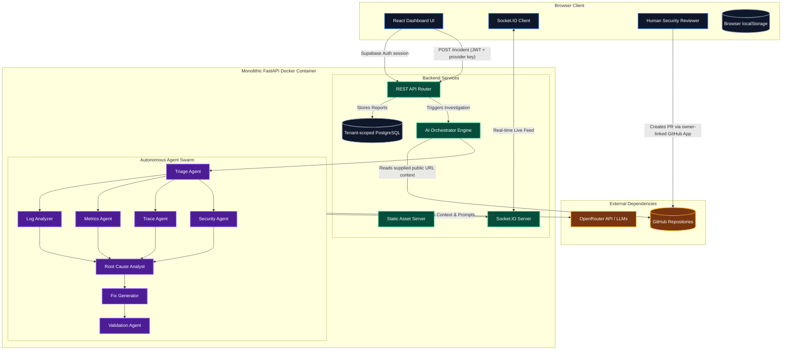

# SwarmOps 🐝

**SwarmOps** is a multi-agent incident response and root-cause analysis platform. It investigates incidents, proposes code patches, and—after strict validation, deterministic policy checks, and an authorized human review—can create a pull request. It does not directly deploy generated code.

🚀 **Live Demo:** [https://swarmops-1.onrender.com](https://swarmops-1.onrender.com)

---

## 🌟 Why SwarmOps is Extraordinarily Useful

In traditional software engineering, **Mean Time To Resolution (MTTR)** for critical production incidents can range from hours to days. When an alert fires, a human Site Reliability Engineer (SRE) or backend developer must manually:
1. Dig through thousands of lines of logs in Datadog or ELK.
2. Cross-reference those logs with CPU/Memory metrics in Prometheus or Grafana.
3. Trace the request path using Jaeger or Zipkin.
4. Clone the repository and hunt for the exact line of code causing the bug.
5. Write a patch, test it, and submit a Pull Request.

**SwarmOps reduces this entire process to minutes.** 

By orchestrating a swarm of specialized, concurrent AI agents, SwarmOps acts exactly like a Senior SRE team. It parallelizes the investigation—simultaneously reading logs, metrics, traces, and code. It then synthesizes the findings into a single, high-confidence root cause and automatically writes the `git` patch to fix it. This is not just a chatbot; it is an autonomous incident remediation engine that dramatically cuts down downtime and engineering burnout.

---

## 🧠 Concept & Architecture

When a production system throws an alert or an incident is reported, SwarmOps automates the investigation using a **Sequential AI Swarm Pipeline**:

1. **Triage Agent**: Initially classifies the incident and determines the optimal investigation strategy.
2. **Log Analyzer Agent**: Scans application logs for exceptions, stack traces, and anomalies.
3. **Metrics Agent**: Analyzes CPU, Memory, and application latency metrics.
4. **Trace Agent**: Investigates distributed traces to find network bottlenecks or database deadlocks.
5. **Security Agent**: Checks if the incident is a result of a vulnerability (e.g., prompt injection, IDOR) or malicious attack.
6. **Root Cause Agent**: Synthesizes all findings from the previous agents into a definitive root cause analysis.
7. **Fix Generator Agent**: Writes the actual code to fix the bug (generates a `git` patch).
8. **Validation Agent**: Ensures the proposed fix is logical, secure, and passes basic sanity checks.

As agents work, they send progress events in **real time** over authenticated WebSockets. Raw model token streams and unrestricted chain-of-thought are not exposed.

### 🗺 Detailed System Architecture



### ⚙️ Technical Deep Dive

SwarmOps is built with a meticulously designed architecture that balances high performance with strict security:

1. **Single-container deployment**: The Vite/React frontend is served by FastAPI in the current deployment layout.
2. **Verified identity and tenant isolation**: Supabase access-token signatures, issuer, audience, and expiry are verified by the backend. Incident rows, database queries, and realtime events are scoped to the authenticated owner.
3. **Fail-closed AI validation**: The validation agent must satisfy a strict JSON schema. A separate deterministic patch policy rejects secrets and protected paths; generated tests are marked as unexecuted and do not count as proof.
4. **Human-controlled GitHub action**: A security reviewer or administrator can request a PR only through that user's linked GitHub App installation. The backend context-checks the patch and stores success only after GitHub returns a verified PR URL and number.

---

## 📖 Usage Guide

Using SwarmOps is designed to be as seamless as possible:

1. **Authenticate**: Sign in with GitHub through the configured Supabase Auth provider. The frontend needs `VITE_SUPABASE_URL` and `VITE_SUPABASE_ANON_KEY`; the backend independently verifies the resulting access token.
2. **Link GitHub App**: Install the configured GitHub App from the setup page. Repository access is limited to repositories selected for that installation; no personal access token is stored.
3. **Report an Incident**: On the Dashboard, click **New Investigation**. Provide a brief description, affected service, and a canonical HTTPS GitHub repository URL. Public URL context fetch is public-only.
4. **Watch the Swarm**: Authenticated Socket.IO progress events are delivered to the user's private room; raw model token streams are not sent.
5. **Review Findings**: Check the root cause, confidence, proposed patch, policy findings, and `tests_executed` state (currently false; generated tests have not been executed).
6. **Request a PR**: Only a `security_reviewer` or `administrator` role in trusted Supabase `app_metadata.roles` can approve a policy-cleared proposal. SwarmOps creates a pull request, not a deployment.

---

## 🔒 Privacy & Data Collection

SwarmOps is built with a **Privacy First** mindset:
- **Verified account identity:** Supabase user IDs are used for ownership; incident records, audit events, and GitHub installation links are stored in PostgreSQL.
- **Separate credentials:** Supabase access tokens authorize the app; optional model-provider keys are a separate header. GitHub App installation tokens are minted short-lived for backend operations and are never persisted.
- **Production persistence:** Configure a PostgreSQL `DATABASE_URL` and run Alembic migrations. Incident and audit data are not stored in a JSON fallback.

---

## 🛠 Tech Stack

### Backend (AI Pipeline & API)
* **Python 3.11+**
* **FastAPI**: High-performance async web framework.
* **Socket.IO**: Real-time event streaming (`python-socketio`).
* **Pydantic**: Strict data validation.
* **OpenRouter**: The LLM engine powering the agents (dynamic client initialization per request).

### Frontend (Real-time Dashboard)
* **React + Vite**: Blazing fast frontend build tool.
* **Tailwind CSS**: Utility-first styling with custom Dark Cosmic Glassmorphism UI.
* **Framer Motion**: Smooth, high-performance animations and 3D parallax effects.

---

## 🚀 Getting Started (Local Development)

### 1. Setup Backend
```bash
cd backend
python -m venv .venv
source .venv/bin/activate
pip install -r requirements.txt
```

### 2. Setup Frontend
```bash
cd frontend
npm install
npm run build
```

### 3. Run the Monolith
The FastAPI backend is configured to serve the compiled React frontend automatically.
```bash
cd backend
uvicorn main:socket_app --host 0.0.0.0 --port 8000 --reload
```
Open `http://localhost:8000` in your browser after configuring Supabase Auth, PostgreSQL, CORS, and the public base URL. For local development, use `.env.example` as a starting point and set the matching `VITE_SUPABASE_URL` and `VITE_SUPABASE_ANON_KEY` when building the frontend.

---

## ☁️ Deployment

SwarmOps is configured as a **Single-Container Monolith** using a multi-stage Dockerfile. This means the React frontend and Python backend are built and hosted together in the exact same container.

To deploy on Render:
1. Create a new **Web Service**.
2. Connect your GitHub repository.
3. Set the **Root Directory** to `backend`.
4. Set the **Dockerfile Path** to `Dockerfile`.
5. Configure `APP_ENV`, `DATABASE_URL`, `SUPABASE_URL`, `SUPABASE_JWT_AUDIENCE`, `CORS_ALLOWED_ORIGINS`, `PUBLIC_BASE_URL`, and `APP_STATE_SECRET`.
6. For GitHub PR support, configure `GITHUB_APP_ID`, `GITHUB_APP_SLUG`, and `GITHUB_APP_PRIVATE_KEY`. Set the GitHub App setup URL to `https://<your-host>/api/v1/github/installation/callback`; grant only Metadata read, Contents read/write, and Pull requests read/write permissions.
7. Build the frontend with `VITE_SUPABASE_URL` and `VITE_SUPABASE_ANON_KEY`; enable GitHub as a Supabase Auth provider and allow the app callback URL.
8. Apply schema changes with `cd backend && alembic upgrade head`.

The backend is unavailable for authenticated operations if its required JWT or database configuration is missing. Approval roles must be assigned through trusted Supabase `app_metadata.roles`; user-editable metadata is not accepted.

---

## 🤝 Contributing
Contributions, issues, and feature requests are welcome! Feel free to check the issues page.
